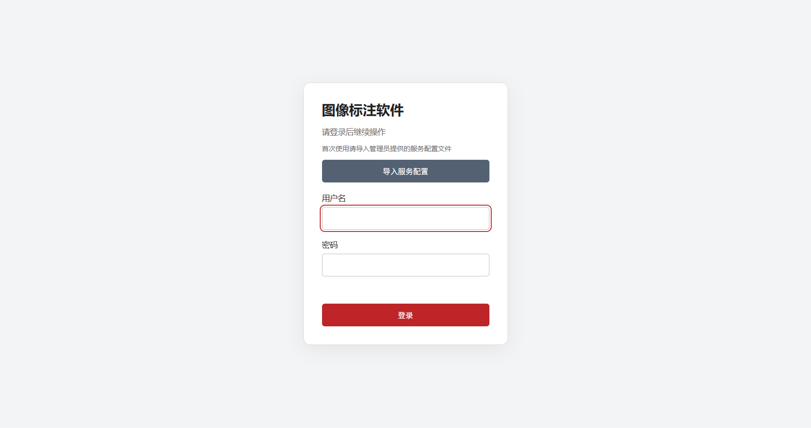
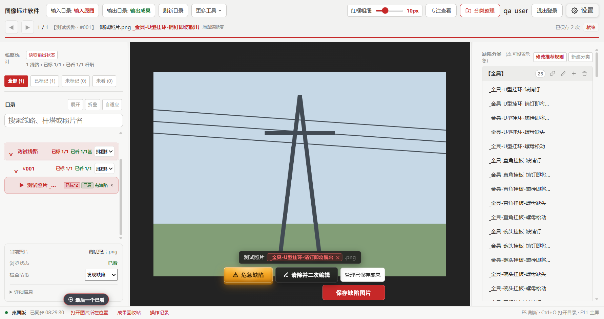

# 巡检缺陷图像标注软件操作手册

适用版本：**50.4.0 整合版**

更新日期：2026 年 10 月 21 日

运行环境：Windows 10 / 11，64 位（x64）

## 目录

1. [版本与下载](#1-版本与下载)
2. [安装与升级](#2-安装与升级)
3. [首次服务配置](#3-首次服务配置)
4. [登录、离线使用和退出登录](#4-登录离线使用和退出登录)
5. [五分钟完成第一张图片](#5-五分钟完成第一张图片)
6. [工作区和目录管理](#6-工作区和目录管理)
7. [圈框、标签和危急缺陷](#7-圈框标签和危急缺陷)
8. [保存队列和二次编辑](#8-保存队列和二次编辑)
9. [成果分组、撤回和回收站](#9-成果分组撤回和回收站)
10. [分类整理和命名维护](#10-分类整理和命名维护)
11. [同步、进度和草稿](#11-同步进度和草稿)
12. [模板、主题和快捷键](#12-模板主题和快捷键)
13. [数据备份、迁移和卸载](#13-数据备份迁移和卸载)
14. [常见问题](#14-常见问题)
15. [验收建议和技术边界](#15-验收建议和技术边界)

## 1. 版本与下载

本版同时保留原桌面程序的目录自动同步、成果分组管理、成果回收站、操作记录，和联网版的账号登录、机器码、24 小时会话、托盘及打包保护。

打开 [GitHub Releases](https://github.com/JupiterLXV/xunjian-desktop/releases/latest)，在 Assets 中下载：

- `xunjian-desktop-50.4.0-windows-x64-setup.exe`：中文安装程序，普通使用者选此文件。
- `xunjian-desktop-50.4.0-windows-x64-portable.exe`：可选免安装版本。
- `xunjian-desktop-50.4.0-source.zip`：维护和开发所需源码，不是安装程序。
- `USER_MANUAL.zh-CN.md`：本手册的独立副本（仓库内文件名为 `操作手册.md`）。
- `SHA256SUMS.txt`：下载文件的 SHA-256 摘要。

GitHub 自动提供的 Source code 压缩包也仅包含源码。不要把源码 ZIP 当成可直接运行的桌面程序。

可在下载目录打开 PowerShell 检查安装包：

```powershell
Get-FileHash -Algorithm SHA256 -LiteralPath '.\xunjian-desktop-50.4.0-windows-x64-setup.exe'
```

将结果与同一 Release 的 `SHA256SUMS.txt` 比较。

## 2. 安装与升级

### 2.1 首次安装

1. 保存其他正在处理的工作，退出旧版巡检程序。
2. 双击安装程序，阅读中文欢迎页。
3. 选择当前 Windows 用户可写入的安装目录。
4. 完成安装，从桌面或开始菜单中的“图像标注软件”启动。

安装包已包含 Electron 运行组件，不需要安装 Node.js、Python 或 Java。默认仅为当前 Windows 用户安装。

当前安装程序未使用商业代码签名，系统可能显示未知发布者。核对来源和文件摘要后，按所在单位的软件安装要求处理。

### 2.2 从旧版本升级

1. 在旧版完成保存，检查保存队列中没有失败或等待任务。
2. 备份输入目录、完整输出目录及本机用户数据，方法见第 13 节。
3. 正常退出旧程序，包括托盘中仍运行的窗口。
4. 运行新版安装程序，选择原安装位置进行覆盖升级。
5. 首次使用公开整合版时导入服务配置，并重新登录。
6. 检查输入、输出目录是否恢复；若未恢复，重新选择原目录。
7. 抽查一张已有照片、一个二次编辑成果组和一项回收站记录。

内部应用名称仍为“巡检缺陷工具”，用于沿用旧的用户数据目录。对外窗口和快捷方式名称为“图像标注软件”。不再导入或校验旧 `.xjlic` 授权文件。

不要先运行旧版卸载程序再升级：部分旧版卸载器会清理用户数据。直接覆盖安装，并提前完成备份。

## 3. 首次服务配置

### 3.1 获取配置文件

公开仓库及公开安装程序不内置实际服务的共享密钥。请从服务管理员处私下取得 JSON 配置文件。格式如下：

```json
{
  "baseUrl": "https://your-inspection-service.example",
  "keyBase64": "管理员提供的 Base64 编码 AES 密钥"
}
```

`baseUrl` 是服务根地址，可包含端口；程序会自动使用固定的登录和保存接口路径，不要把 `/manage/api/v1/login` 填入根地址。`keyBase64` 必须对应服务端配置，解码长度为 16、24 或 32 字节。仓库中的示例不能直接用于登录。

服务端若只提供 HTTP，本版兼容该协议；HTTPS 可额外保护连接。AES-CBC 按既有后端协议实现，不等于 HTTPS，也不提供独立的认证标签。

### 3.2 导入配置

1. 启动程序，在登录页点击“导入服务配置”。
2. 选择管理员提供的 `.json` 文件。
3. 页面显示“已配置登录服务”及服务地址后，再输入账号和密码。
4. 也可使用原生菜单“帮助 → 导入登录服务配置…”。

导入成功后，配置由 Windows 系统安全存储加密保存到当前用户的数据目录，后续启动无需重复导入。原始 JSON 包含共享密钥，应私下保管，不要提交 GitHub 或附在公开问题中。

更换服务时先完成保存并“退出登录”，再导入新配置。已登录状态下程序会阻止直接更换服务。若本机配置无法解密，重新导入原始 JSON；不要手动编辑加密的 `api-config.bin`。



### 3.3 管理员分发

给使用者提供安装包、服务配置 JSON 和账号使用说明。账号由后端创建，本软件没有注册或重置密码入口。服务配置与账号分别保管，避免把实际配置放进公开 Release。

## 4. 登录、离线使用和退出登录

1. 确保已导入正确服务配置，电脑可以连接服务地址。
2. 输入后端用户名、密码，点击“登录”。
3. 程序读取本机机器码，将登录请求加密后发送到后端。
4. 后端返回有效会话后进入工作台。

机器码可在“帮助 → 本机机器码”查看。向管理员反馈设备授权问题时，提供该机器码即可，不要发送密码或登录凭据文件。

登录从成功时刻起固定有效 **24 小时**。例如上午 9:00 登录，通常到次日上午 9:00 需要重新联网登录；离线重启不会延长有效期。

- 有效期内可离线浏览、标注、保存、分类整理及恢复成果。
- 当前普通保存和危急保存仅写入本地，不调用后端保存记录接口，不上传图片。
- 到期后不能开始新的受保护文件修改，需要重新登录。
- 到期前已经开始的单文件写入允许完成或中止；整批任务剩余部分可能需要登录后重试。
- 使用结束可点击工具栏“退出登录”。有保存或文件处理任务时，先等待其完成。

登录凭据由主进程通过系统安全存储加密保存，页面不保存 token。系统安全存储不可用时不会降级为明文。离线期间不会主动向服务器查询账号撤销状态；24 小时限制依赖本机时钟。

## 5. 五分钟完成第一张图片

### 5.1 准备目录

建议将输入原图与输出成果放在两个独立目录，并放在程序安装目录之外。例如：

```text
巡检项目/
  输入原图/
    测试线路/
      #001/
        照片001.JPG
        照片002.JPG
  输出成果/
```

### 5.2 打开并标注

1. 登录后点击工具栏“输入目录”，选择包含巡检照片的总目录。
2. 点击“输出目录”，选择“输出成果”总目录。
3. 在左侧目录树中选中照片，在中央查看大图。
4. 从右侧缺陷分类中点击适用标签，检查底部文件名预览。
5. 在图片上按住鼠标左键拖动，圈出缺陷范围。
6. 点击“保存缺陷图片”，或按 `Alt+S`。
7. 等待成功提示，并确认保存任务处于完成状态。
8. 打开输出目录抽查成果图片。

普通保存通常同时生成“缺陷原图”中的未圈图和“缺陷圈示图”中的圈示图；若当前判定为危急，会额外生成危急副本。输入原图在正常保存过程中保持不变。

选择输出目录时，应选包含这些成果子目录的上一级目录。不要直接选择“缺陷原图”“缺陷圈示图”或“危急缺陷”子目录。

## 6. 工作区和目录管理

- 顶部工具栏：输入、输出目录，线条粗细，分类整理，账号及设置。
- 左侧目录树：按目录查看图片、搜索定位、观察已看和已标记状态。
- 中央大图：查看、缩放、平移、圈示。
- 图片下方：文件名预览、二次编辑、管理已保存成果、保存按钮。
- 右侧面板：选择、维护缺陷分类和标签。
- 底部桌面栏：同步状态、打开图片位置、成果回收站、操作记录。

点击输入目录可连接记忆中的目录；右键输入目录按钮可强制更换目录。输出目录按钮同样支持右键更换。切换前处理完保存任务和未保存编辑。

拖动左右分隔线调整侧栏宽度。双击分隔线可按界面提示自适应。图片文件变化会自动同步，也可按 F5 立即刷新。

以下工作台截图使用合成测试图片和测试账号，不含业务照片。



## 7. 圈框、标签和危急缺陷

### 7.1 圈示

在图片上左键拖动绘制红框，可在工具栏调节线条粗细。选中红框后按 `Delete` 或 `Backspace` 删除；`Ctrl+Z` 可撤回圈框及命名编辑。

鼠标右键拖动用于平移。设置中可启用图片区域单击切图：左键单击下一张、右键单击上一张，拖动仍保留圈框或平移行为。

### 7.2 标签

点击右侧标签将其应用到当前图片，保存前检查文件名预览。分类和标签可以在设置及分类管理界面维护，模板支持导入导出。

删除或重置模板分类会影响后续可选标签；不会自动重写已经导出的历史成果。需要统一历史成果命名时使用明确的命名维护操作并先备份。

### 7.3 危急缺陷

缺陷标签旁的危急标记可维护该标签的危急属性，也可按界面设置当前照片的危急判定。正常保存根据判定生成自动危急副本。

“危急缺陷”独立保存只写入危急缺陷目录，与普通保存分别管理。仅撤回危急成果不会删除其他两类成果；取消整张照片的缺陷标记会撤回其对应的三类成果。

危急判定来自用户和模板规则，程序不会自动完成工程专业判断。

## 8. 保存队列和二次编辑

### 8.1 保存队列

保存任务在后台执行，并显示排队、合成、写入、已保存或失败状态。不要把按钮已点击当作保存完成。

任务失败时打开保存任务面板，先处理原因，再点击“重试”。常见原因包括磁盘空间不足、目录已移动、外接盘断开、文件被其他软件占用或会话已到期。

“移除任务”表示放弃该失败任务的后续重试，不等于已经成功导出。需要重新保存时回到原输入和输出目录。

程序采用临时文件、完整写入后提交及事务恢复记录保护已有成果。正常退出会等待任务和本地记录保存；强制结束进程或断电仍可能丢失最后一瞬间的编辑。

### 8.2 同一原图保存多种缺陷

1. 完成第一组圈示、标签和保存。
2. 点击“清除并二次编辑”。
3. 界面切回纯净原图，重新圈示并选择第二组标签。
4. 再次保存，生成独立的成果组。
5. 点击“管理已保存成果”检查两组是否都在。

二次编辑不会覆盖第一组。需要撤回一组时使用成果组管理，不要通过删除输入原图来撤回成果。

重名时程序会按规则追加编号，避免覆盖不相关文件。保存后的最终文件名以输出目录中的实际名称为准。

## 9. 成果分组、撤回和回收站

### 9.1 按组查看与删除

在当前图片下方点击“管理已保存成果”。每组显示预览、标签和文件清单。点击“删除这一组”会把该组关联成果移入应用的成果回收站，其他组及输入原图保留。

删除过程中若文件或索引被其他软件修改，程序会停止并提示刷新，避免按过期清单操作。

### 9.2 取消整张图片的标记

取消已标记状态会要求确认。确认后，当前照片对应的圈示图、输出原图及危急成果会一并撤回到成果回收站。这里的“输出原图”是输出目录内的副本，输入目录中的巡检原图不在撤回范围内。

### 9.3 恢复

1. 确认已经连接正确的输出总目录。
2. 点击底部“成果回收站”，或菜单“视图 → 成果回收站”。
3. 按时间和文件数量找到需要恢复的记录。
4. 点击“恢复”，等待完成后检查图片和状态。

回收站只显示当前输出目录的记录。它不是 Windows 系统回收站，资料实际位于输出目录下的 `.xunjian-trash-v1`。

如果原位置已有同名文件，程序拒绝覆盖。先备份并核对冲突文件，再调整冲突后重试。回收站备份校验失败时也会停止恢复。

不要手动删除 `.xunjian-trash-v1` 或其中的 `manifest.json`；删除后将失去这些成果的恢复能力。本版没有自动清空成果回收站功能。

### 9.4 操作记录

点击“操作记录”查看最近 500 条保存、删除、恢复等记录。记录用于排查和追溯，不是图片备份。失败的保存任务应在保存任务面板中重试。

## 10. 分类整理和命名维护

“分类整理”在本机磁盘中处理成果文件和对应索引，并显示进度。操作前先确认输出目录和整理预览，建议备份完整输出目录。

设置中的“全绝缘分类关键词”按缺陷标签匹配，用逗号分隔；未匹配项归入其他缺陷。默认包含“绝缘”，因此包含该词的绝缘子相关标签也可能归入全绝缘缺陷。

“规范输出命名”和“清理文件名乱码”用于处理支持的历史命名、随机后缀或不可见字符。执行前查看预览，无法判断的乱码不会自动猜改。

整理失败时程序尝试回滚。若提示存在恢复资料或外部修改，先备份整个输出目录，避免手动删除隐藏索引和恢复日志，再使用“读取输出状态”或重新连接目录。

## 11. 同步、进度和草稿

### 11.1 自动同步

本地目录监测会捕获外部增删与修改；程序也在恢复焦点及周期检查时同步。正在保存、切图、拖动或编辑时会延后部分自动刷新。按 F5 或“刷新目录”可以主动同步。

刷新更新当前文件模型，不会重新载入整张界面，现有未保存草稿尽量保留。若原图被外部删除，程序会提示草稿仍保留；放回同路径原图后可继续检查编辑。

外接盘或网络目录的通知能力可能不同，遇到不同步先按 F5；仍失败时检查路径和权限。

### 11.2 已看和已标记

连接已有输出目录时，程序扫描三类成果及分类子目录，恢复能唯一对应的已看、已标记状态。也可在“设置 → 输出与进度 → 读取输出状态”手动执行。

重名且无法唯一对应的成果会保留并提示，不会随意归属或删除。没有输出成果的已看进度依赖本机记录，不能只凭图片文件夹完整恢复。

“重置清空已看记录”不删除图片。以后重新读取输出状态时，有成果的图片仍可能恢复为已看。

### 11.3 草稿

圈框和标签会在编辑后自动写入本机草稿，重新打开相同目录时尝试恢复。草稿恢复提示不代表成果已经导出；最终交付前必须检查保存队列和输出图片。

正常关闭程序前会检查保存任务、草稿和本地记录。若关闭被阻止，回到界面处理失败任务。任务栏强制结束或关机不能替代正常退出。

## 12. 模板、主题和快捷键

分类模板可导出为 JSON，再在另一台电脑或同类版本中导入。导入后检查缺陷分类、危急属性、推荐规则和候选词池是否符合项目要求。浏览器版的本地存储不会自动迁入桌面版。

主题、侧栏、图片导航和快捷键均可在设置中调整。全局界面缩放由桌面菜单提供，图片缩放和平移按工作台交互处理。

默认常用快捷键：

- `Ctrl+O`：打开图片目录。
- `Ctrl+Shift+O`：选择输出目录。
- `Ctrl+F`：搜索目录。
- `Ctrl+Shift+E`：在资源管理器中定位当前图片。
- `F5`：刷新目录。
- `Alt+S`：保存缺陷图片。
- `F`：默认自定义保存键，可在设置中修改。
- `A` / `D` 或 `←` / `→`：上一张、下一张，可调整自定义按键。
- `Delete` / `Backspace`：删除选中的圈框。
- `Ctrl+Z`：撤回圈框和命名编辑。
- `F11`：进入或退出全屏；全屏时 `Esc` 可退出。
- `Ctrl++` / `Ctrl+-` / `Ctrl+0`：放大、缩小或恢复整个界面。
- `Ctrl+,`：打开设置。

输入文字、登录界面和弹窗中，部分工作台快捷键会被屏蔽，避免误操作。

Windows 托盘图标单击或双击可显示主窗口，右键可显示窗口或退出。关闭主窗口仍执行保存检查后退出，不会自动变成常驻后台。

## 13. 数据备份、迁移和卸载

### 13.1 需要保留的三部分

1. **输入原图目录**：现场照片及原始目录结构。
2. **完整输出目录**：三类成果、分类子目录、隐藏索引及成果回收站。
3. **当前用户数据目录**：在资源管理器地址栏输入 `%APPDATA%\巡检缺陷工具`。

用户数据包括目录授权、窗口布局、模板与本地存储、IndexedDB 草稿和进度、操作记录、加密会话及服务配置。关闭程序后再复制整个目录作为备份。

输出目录中的隐藏文件和文件夹承担索引、恢复和回收用途，迁移时不要只复制 JPG/PNG 文件。仅复制图片会丢失部分关联、恢复能力和操作上下文。

### 13.2 换电脑

将输入、完整输出目录和导出的模板复制到新电脑。安装程序后重新导入服务配置、重新登录，再选择目录并读取输出状态。

Windows 安全存储与系统用户有关，复制 `session.bin` 或 `api-config.bin` 不能保证在另一台电脑解密。草稿和目录身份也不保证跨电脑无损自动迁移；迁移前先把需要交付的编辑导出为成果。

### 13.3 卸载和回退

本版卸载通过 Windows“设置 → 应用”执行，移除程序和快捷方式，保留用户数据。外部输入目录、输出成果和成果回收站不删除。

若以后需要清理用户数据，请先确认备份完整并退出程序。清除用户数据会失去目录记忆、设置、未导出草稿和本地进度，需要重新导入配置和登录。

回退到旧版前保留本版数据副本。旧版可能不认识新增索引或回收资料，也可能有不同卸载行为；不要在同一套数据上来回试验而不备份。

## 14. 常见问题

### 提示“请先导入服务配置”

点击登录页“导入服务配置”，选择管理员的真实 JSON 文件。示例中的空密钥无法登录。

### 提示“服务配置无法解密”

确认仍在原 Windows 用户下运行，重新导入原始 JSON。不要修改 `.bin` 文件，也不要把其内容发到公开问题中。

### 登录失败或权限校验失败

核对账号、密码、网络、服务根地址及 AES 密钥。确认系统时间正确。若账号或机器码未获后端许可，请管理员检查。程序没有可替代后端登录的默认万能账号。

### 离线时突然不能保存

检查是否已超过本次登录的 24 小时有效期。联网重新登录后，再在原目录中重试失败任务。有效会话内的普通保存不依赖后端保存接口。

### 打开目录后没有图片

确认选择的是包含照片的目录、磁盘已连接且有读取权限。递归目录扫描支持常见 JPG/JPEG、PNG、WebP、BMP、TIFF 扩展名；能否解码具体 TIFF 或特殊图片取决于运行时，不支持时可先转为 JPG/PNG。

### 输出目录选择错误

选择三个成果子目录的上一级总目录。不要把输入目录或某个成果子目录误当输出总目录。

### 文件夹修改后界面没变化

等待当前保存或切换完成，关闭管理弹窗后按 F5。外接盘重新连接后必要时重新选择目录。

### 保存失败、磁盘已满或文件占用

保留原图和现有成果，先解决空间、连接或占用问题，再重试。不要为了清理错误而直接删除隐藏恢复文件。

### 回收站恢复提示同名文件

程序不会覆盖新出现的同名文件。备份并核对冲突文件，将不相关文件另存后再恢复；不清楚时先保存完整目录副本。

### 草稿恢复了，输出目录却没有新图片

草稿只表示编辑状态已保存在本机。点击保存，等待任务完成，再检查实际输出。

### 旧 `.xjlic` 授权无效

整合版使用后端账号登录。旧离线授权不参与本版启动或认证。

### 需要向维护者反馈

菜单“帮助 → 导出诊断信息…”可保存版本及近期错误。反馈时说明操作步骤、错误文字、是否登录、目录类型和可复现的合成示例。诊断信息可能含文件名或路径，公开提交前先检查，不要附账号密码、真实服务配置或业务照片。

## 15. 验收建议和技术边界

建议在实际工作电脑上先用少量复制的测试照片，完成登录、离线保存、二次编辑、按组删除、回收站恢复、外部文件同步、关闭重启和目录迁移验收，再处理正式数据。

当前自动化测试使用随机密钥和本机模拟后端，验证接口协议与桌面流程；不代表已经使用你的真实账号完成服务端联调。实际后端账号权限、网络和部署配置需要在你的使用环境确认。

混淆、ASAR 完整性和 Electron 开关用于增加修改成本，不保证无法逆向。安装包未商业签名。详细验证范围和未覆盖事项见 [验证记录](docs/验证记录.md)。
